# Research figures through R62

Generated by `info/plots/make_current_plots.py` from public aggregate JSON. Figures are 7.2 inches wide, with vector PDF and 300-dpi PNG exports. [Review and coverage](../REVIEW.md) explains the older figures and remaining gaps.

## R35: state learning does not establish added paired information

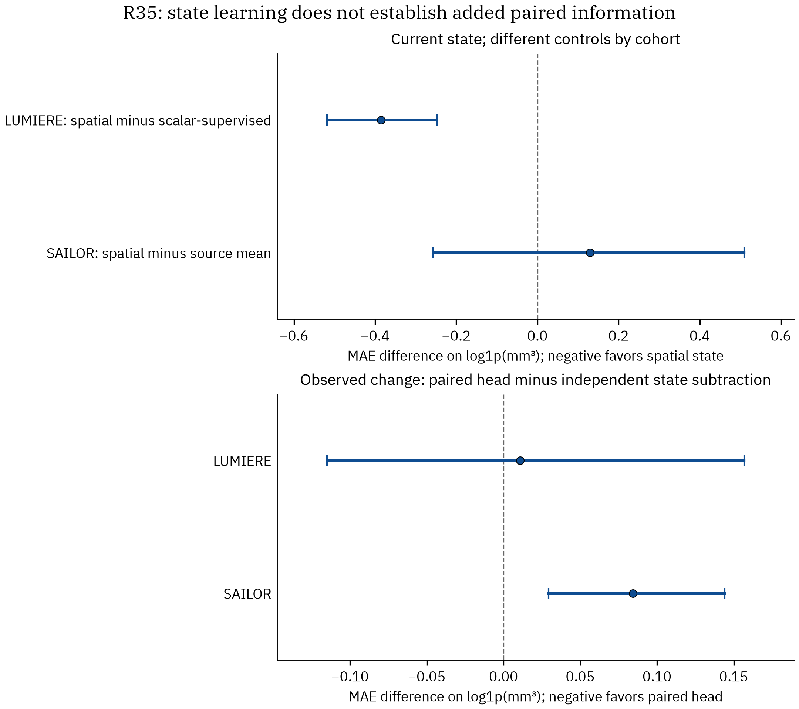

State intervals are ordinary 95% patient bootstraps. Observed-change intervals are family-12 adjusted 99.583% intervals. Scores average three fitted seeds. LUMIERE has 149 visits from 26 patients and 117 pairs from 23; SAILOR has 269 visits and 242 pairs from 27. The spatial model also receives dense mask supervision, so the state gain does not isolate architecture. Both scans are observed for paired change. Cohort-specific controls and panel scales differ. The JSON cites the reviewed numerical receipts, including the corrected independent-state comparison.

[PDF](r35_state_and_change.pdf) · [Source aggregate](../../plots/reviewed_reference_metrics.json)

## Corrected-cache adaptation reverses the old zero-shot ordering

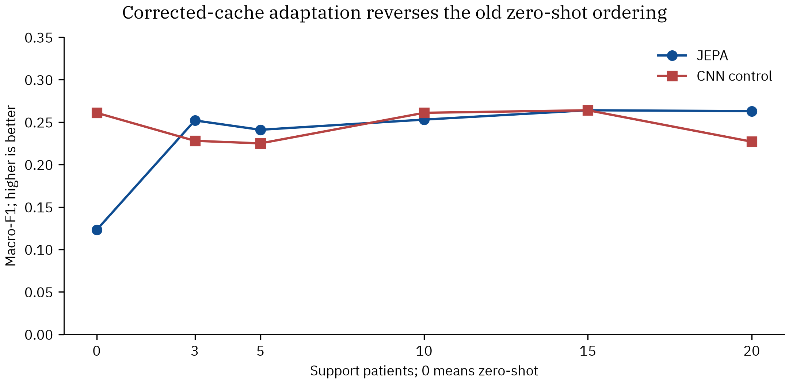

Recorded corrected SAILOR response-category scores. Lines connect evaluated support sizes; no uncertainty estimates are supplied. The CNN column is the recorded control, not the entire historical CNN sweep. SAILOR is reused development data and the response-code mapping lacks independent confirmation. These curves supersede the legacy adaptation plots as a description of the corrected cache; they are not anatomical transfer evidence.

[PDF](corrected_adaptation.pdf) · [Source aggregate](../../plots/reviewed_reference_metrics.json)

## R36: added encoder accessibility remains unresolved

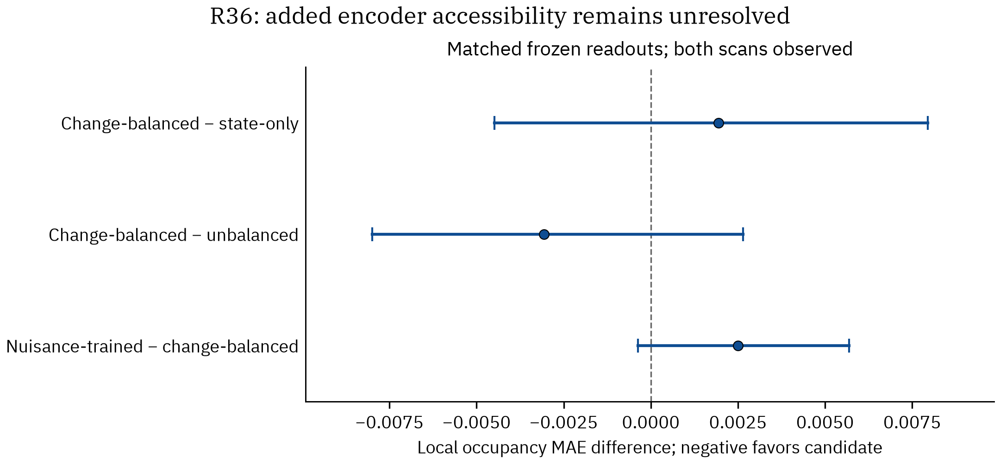

Points show paired patient-uniform error differences across three fitted seeds. Lines are family-three adjusted 98.33% patient-bootstrap intervals on 117 observed pairs from 23 LUMIERE development patients. A is state-only, B is unbalanced change, C is change-balanced, and D adds nuisance training. This is observed change, not forecasting. Negative values favor the first arm.

[PDF](r36_observed_change.pdf) · [Source aggregate](../../r36_phase1_metrics.json)

## R38: joint training did not establish a forecasting gain

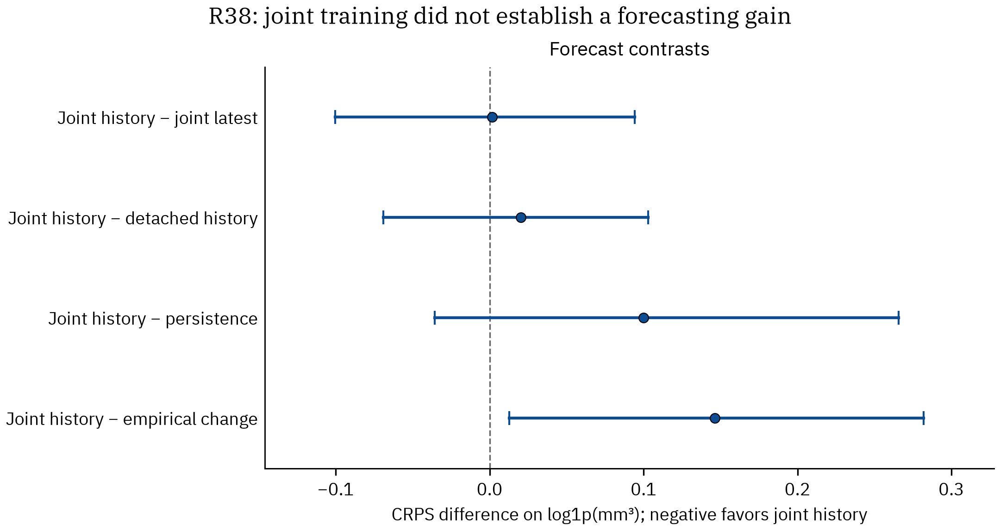

Lines are adjusted 99.5% patient-bootstrap intervals for the selected forecast contrasts. The fixed comparison uses 75 pairs from 18 reused LUMIERE patients and averages fitted seed scores. Joint history also failed current-state retention. Intervals crossing zero do not establish equivalence.

[PDF](r38_joint_training.pdf) · [Source aggregate](../../r38_full_metrics.json)

## R40: a supplied horizon did not establish useful history

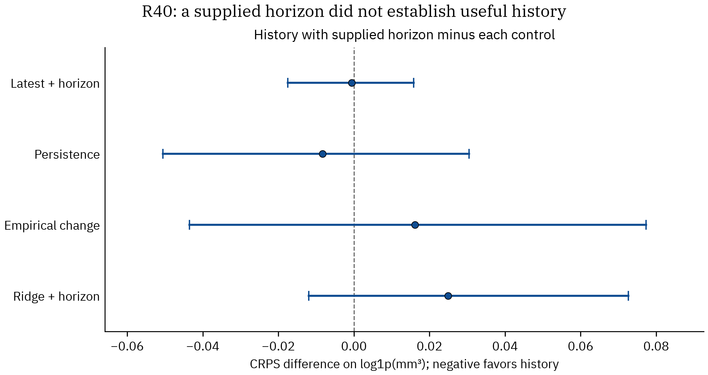

Points are paired patient-uniform CRPS differences; lines are the recorded ordinary 95% patient-bootstrap intervals, not multiplicity-adjusted intervals. The assessment has 75 pairs from 18 reused LUMIERE patients. The realized week-bin horizon is supplied retrospectively. This does not test prospective prediction at a known appointment time.

[PDF](r40_supplied_horizon.pdf) · [Source aggregate](../../r40_full_metrics.json)

## Forecasting controls on reused LUMIERE patients

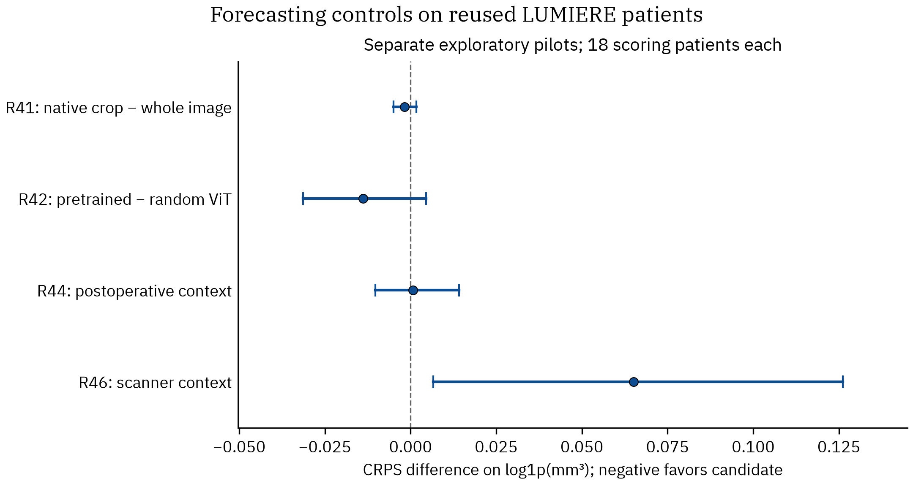

Lines are ordinary 95% patient-bootstrap intervals. Each row tests its own matched control: native versus whole-image history, pretrained versus random ViT history, and inclusion versus omission of postoperative or scanner context. These adaptive pilots are not independent replications or a pooled estimate. Small pilot budgets limit conclusions about convergence.

[PDF](r41_r44_r46_forecast_controls.pdf) · [Source aggregate](../../preaudit_revisit_metrics.json)

## R43: continuous dynamics versus matched discrete transitions

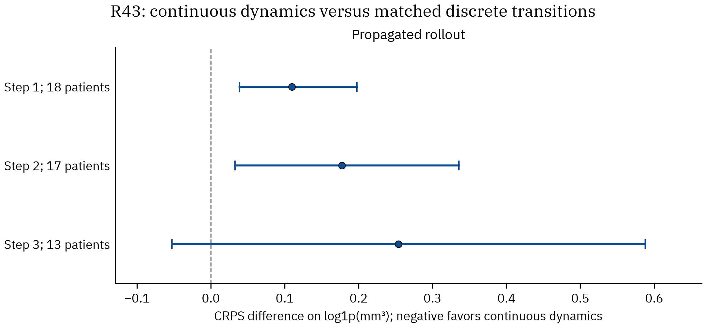

Points are continuous-minus-discrete CRPS differences and lines are ordinary 95% patient-bootstrap intervals. The same fitted models propagate their predictions through successive steps; the eligible patient subset changes with horizon. Time is nominal LUMIERE week-bin time, not exact scan-day time. There is no pooling across horizons.

[PDF](r43_rollout.pdf) · [Source aggregate](../../preaudit_revisit_metrics.json)

## R45/R46: response assessment and perfusion forecasting

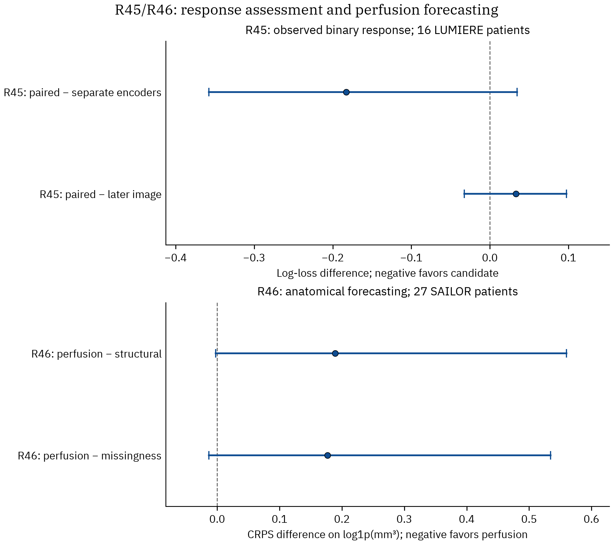

Lines are ordinary 95% patient-bootstrap intervals. R45 assesses binary response after both scans are observed, on 48 pairs from 16 reused LUMIERE patients. R46 forecasts anatomy from cutoff structural measurements with or without perfusion, on 238 pairs from 27 SAILOR development patients. Panels have different units, tasks, and scales. Neither comparison establishes the tested incremental benefit.

[PDF](r45_r46_response_controls.pdf) · [Source aggregate](../../preaudit_revisit_metrics.json)

## R47: current-state gain in-domain, no established history gain

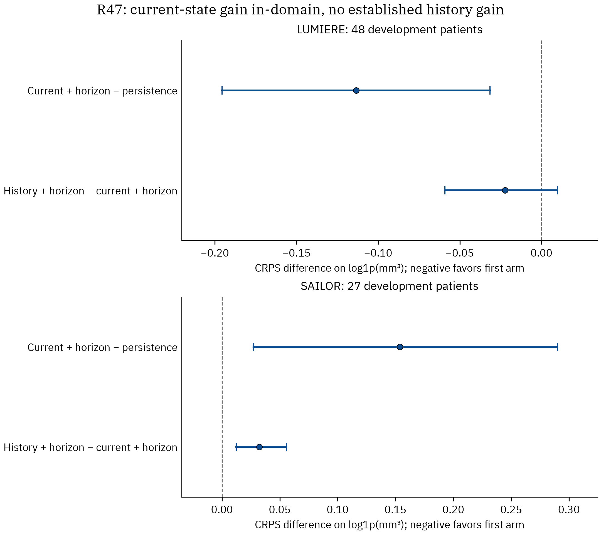

Lines are recorded adjusted 97.5% patient-bootstrap intervals. Current measured anatomy and the retrospectively supplied interval improve the in-domain distributional score against persistence. The history increment is unresolved and the current-state advantage does not transfer. Panels use independent axis limits. Source results average two repeated nested partitions; locked source models supply developmental transfer predictions.

[PDF](r47_current_state_transfer.pdf) · [Source aggregate](../../r47_anatomical_signal_metrics.json)

## R49: matched pretraining improves overlap, absolute Dice stays low

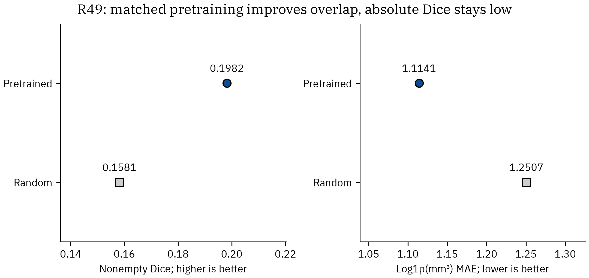

Points are means of patient-uniform scores over two fitted seeds on 60 visits from 13 reused LUMIERE scoring patients. No arm-wise uncertainty is supplied here. Architecture, supervision, patient draws, and selection opportunities are matched. Dice is unitless with 1 indicating perfect overlap. The next figure gives the paired uncertainty and volume-retention criterion.

[PDF](r49_pretraining_scores.pdf) · [Source aggregate](../../r49_pretraining_state_metrics.json)

## R49: paired evidence for an initialization benefit

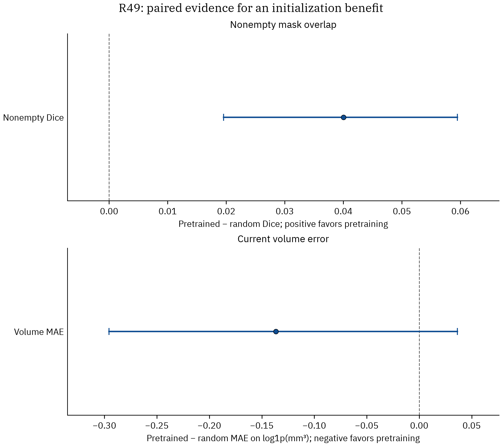

Lines are adjusted 97.5% patient-bootstrap intervals over 13 scoring patients. Both seeds favor pretraining for Dice. The volume interval crosses zero but its upper limit passes the specified +0.05 retention allowance. This supports initialization under the matched recipe, not clinical utility or temporal understanding. Panels have different units.

[PDF](r49_pretraining_contrasts.pdf) · [Source aggregate](../../r49_pretraining_state_metrics.json)

## R50/R51: no accepted primary JEPA gain across the three recipes

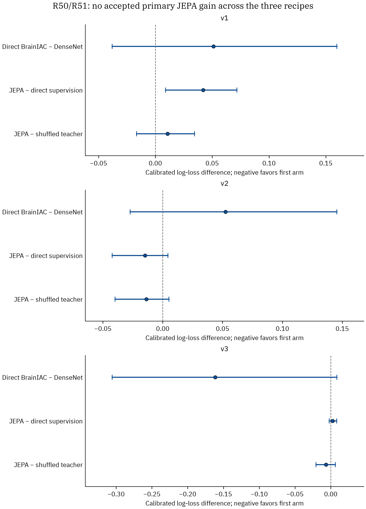

Lines are family-three adjusted 98.33% patient-bootstrap intervals for observed four-class response log loss on 10 reused scoring patients. Versions change bundled training choices and are not a controlled single-factor ablation. v3 recovers fitting readiness; v1 and v2 retain their readiness limitations. Independent panel scales preserve visible uncertainty. The observed-response task is not future forecasting.

[PDF](r50_r51_clinical_objectives.pdf) · [Source aggregate](../../r50_r51_clinical_metrics.json) · [Source aggregate](../../r50_r51_v2_clinical_metrics.json) · [Source aggregate](../../r50_r51_v3_clinical_metrics.json)

## R52: a token-interface replacement was not established

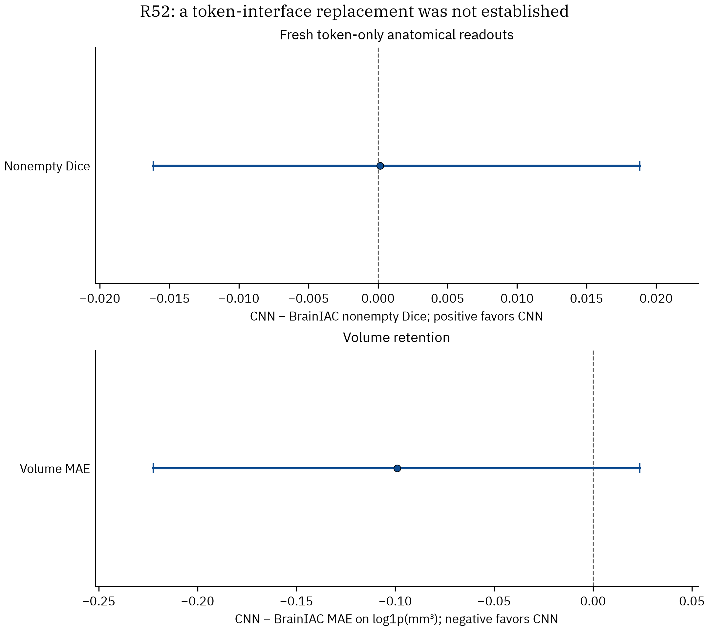

The candidate is the compact CNN, so all signs are CNN minus BrainIAC. Lines are family-three adjusted 98.33% patient-bootstrap intervals on 13 reused LUMIERE patients. Both encoders use the same 216 by 64 token interface and fresh readouts. Mean Dice is about 0.0666 for both. The figure does not identify whether information was lost in the backbone, interface, or readout.

[PDF](r52_token_interface.pdf) · [Source aggregate](../../r52_spatial_token_encoder_metrics.json)

## R53: small completion gain, no useful image-forecast gain

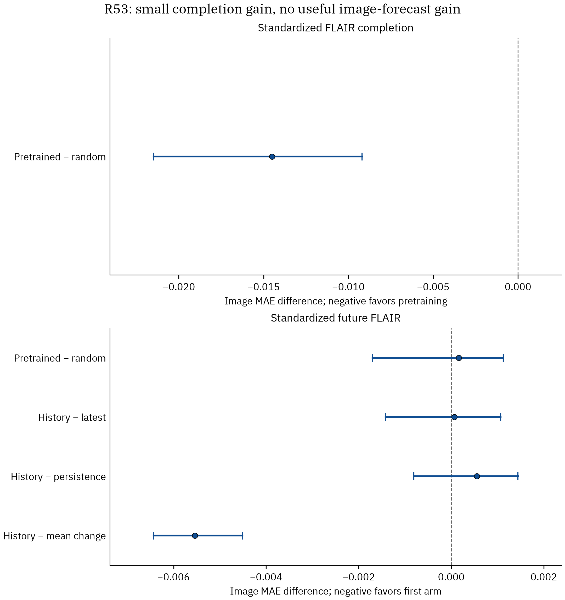

Lines are family-five adjusted 99% patient-bootstrap intervals. Completion uses 13 scoring patients and forecasting uses 10. Errors are in standardized image-intensity units, not physical tissue units. The small completion improvement misses the fixed useful-gain criterion. Separate panel scales avoid hiding the near-zero forecast contrasts.

[PDF](r53_image_prediction.pdf) · [Source aggregate](../../r53_flair_prediction_metrics.json)

## Regional context helps one current-state endpoint

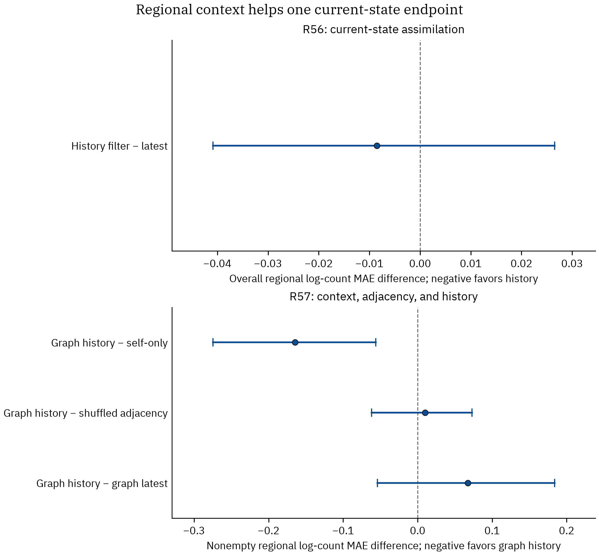

R56 uses ordinary 95% patient-bootstrap intervals; R57 uses family-three adjusted 98.33% intervals. Both score 10 reused patients. R56 scores all regions; R57's primary endpoint scores nonempty regions. Context improves R57 against self-only messages, but adjacency and history increments remain unresolved. These coarse log-count targets predate R60's source-volume correction and require separate confirmation. Panels have different endpoints.

[PDF](r56_r57_regional_context.pdf) · [Source aggregate](../../r56_regional_state_metrics.json) · [Source aggregate](../../r57_regional_graph_metrics.json)

## R58: future-feature alignment did not improve anatomical forecasting

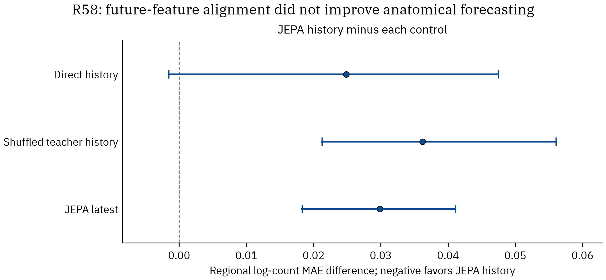

Lines are family-three adjusted 98.33% patient-bootstrap intervals on eight reused scoring patients. Current automated measurements are supplied at inference; future inputs are excluded. Teacher and encoder are frozen. Targets are the coarse regional log-count measurements later questioned by R59 and corrected in R60.

[PDF](r58_future_features.pdf) · [Source aggregate](../../r58_spatial_latent_forecast_metrics.json)

## R48: the short fitting check stopped too early

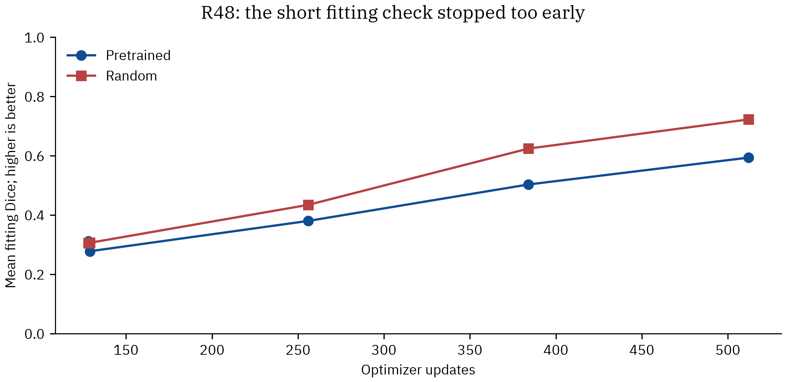

Recorded checkpoints on the same two fitting examples. Lines connect measurements, with no uncertainty band or interpolated observations. Both arms pass the full original fitting criterion by 512 updates. This diagnoses optimization duration; it is not held-out generalization or evidence of pretrained superiority. Dice is unitless.

[PDF](r48_fitting_duration.pdf) · [Source aggregate](../../r48_learning_investigation_metrics.json)

## R54: fitting remains weak even on two examples

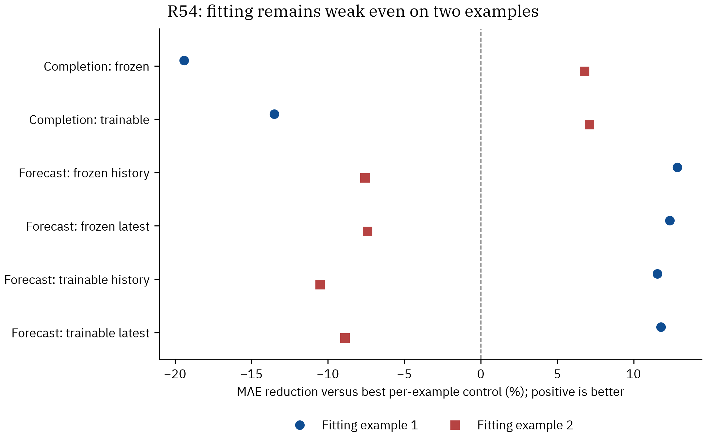

Points are the two examples' relative MAE reductions against their best image control, multiplied by 100. Shape and color identify examples; they are not bootstrap samples or error bars. The best control can differ between completion and forecasting examples. Frozen and trainable describe the MRI encoder. None meets the substantial-fit criterion. These are fitting-only diagnostics, not held-out performance.

[PDF](r54_individual_fitting.pdf) · [Source aggregate](../../r54_flair_learnability_metrics.json)

## R55: bypassing the MRI encoder did not resolve image fidelity

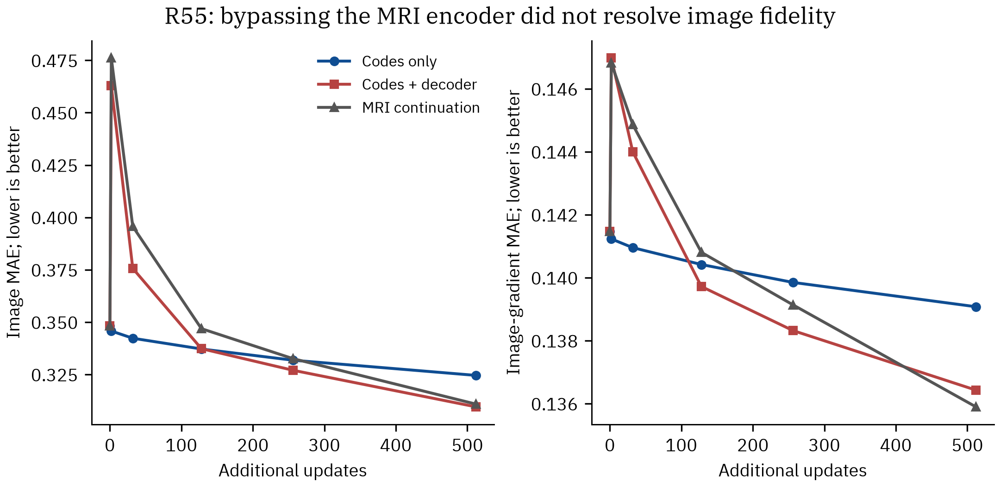

Recorded mean scores on two current fitting images, in standardized intensity units. Codes-only and codes-plus-decoder runs fit target-specific spatial codes. MRI continuation uses the matched additional duration. Lines connect recorded checkpoints; no uncertainty is supplied. None met the full individual-image fitting criterion. These curves do not measure forecasting or generalization. R54's preceding fitting diagnosis also failed its substantial-fit criterion.

[PDF](r55_decoder_fitting.pdf) · [Source aggregate](../../r55_decoder_capacity_metrics.json)

## R59: measured-history comparison before target correction

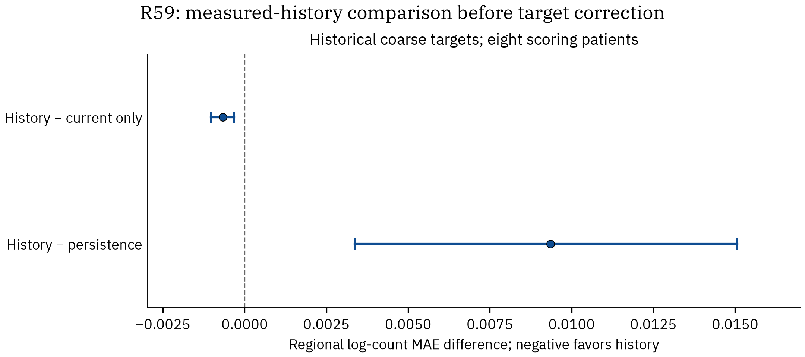

Lines are family-two adjusted 97.5% patient-bootstrap intervals on 30 history pairs from eight reused patients. This comparison uses the old coarse-grid log-count targets. R59's separate inspection of six deliberately selected examples found erased burden and a change-direction disagreement; those examples cannot estimate prevalence. R60 quantifies the defect and R61 repeats the comparison with source-volume targets. Do not compare absolute R59 and R61 errors as a single-factor sampling correction: the logarithm's volume units also changed.

[PDF](r59_coarse_measured_history.pdf) · [Source aggregate](../../r59_measured_history_metrics.json)

## R60: coarse sampling erased burden and reversed some changes

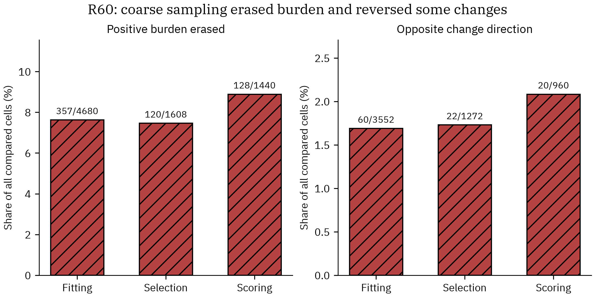

Bars show endpoint-pooled counts divided by all compared region-compartment cells in each partition. Labels give numerator/denominator; these are not percentages among positive cells or patient-uniform forecast scores. No sampling uncertainty is supplied. Source-volume aggregation conserves physical volume. This is a target diagnostic across 322 visits, not a model comparison or proof of biological mask accuracy.

[PDF](r60_target_correction.pdf) · [Source aggregate](../../r60_regional_source_target_metrics.json)

## Corrected measured history still loses to persistence

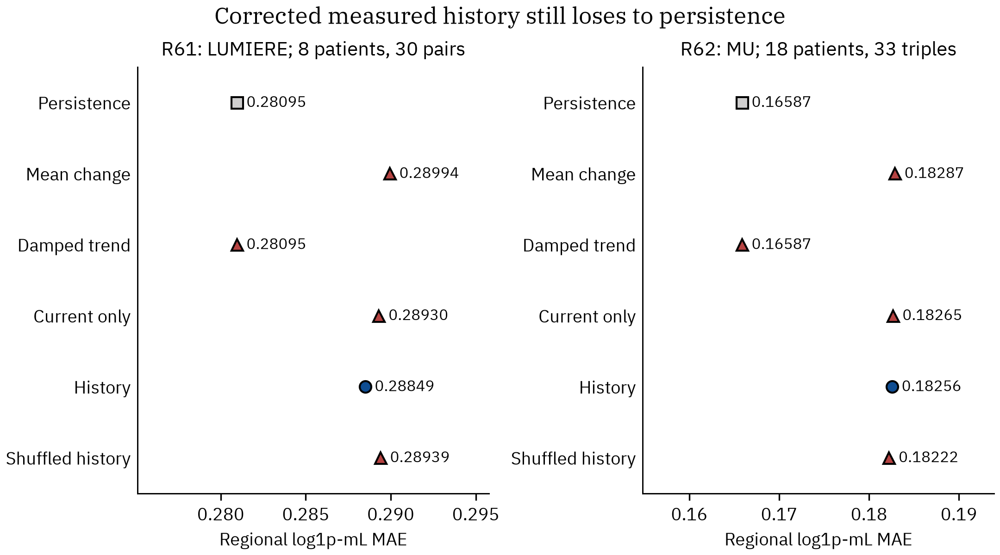

Points show patient-uniform regional MAE of log(1 + volume in mL), not raw mL. Both earlier and current measurements are supplied to history regressions. Persistence copies current measured burden. Trend selects zero and coincides with persistence. No arm-wise uncertainty is supplied. Panels use independent scales and different anatomical tasks: three automated compartments in R61, four reviewed-mask compartments including cavity in R62. Absolute errors are not a cross-cohort leaderboard. All scoring patients are development evidence; MU's forty reserved patients remain unopened.

[PDF](r61_r62_measured_history.pdf) · [Source aggregate](../../r61_corrected_history_metrics.json) · [Source aggregate](../../r62_mu_history_metrics.json)

## Small history increments do not beat persistence

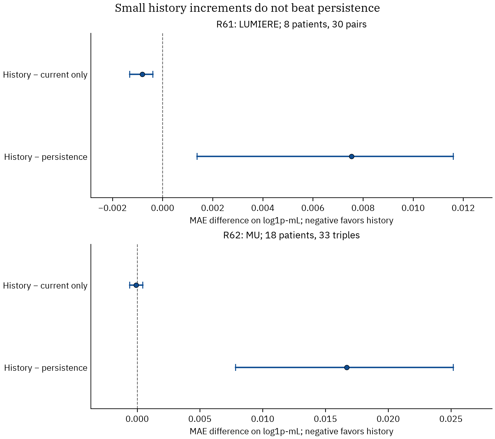

Lines are family-two adjusted 97.5% paired patient-bootstrap intervals. R61's history-minus-current interval excludes zero but the gain misses the fixed 5% practical threshold. R62's corresponding interval crosses zero. Both history-minus-persistence intervals favor persistence. Panels have independent scales and different compartment definitions; do not pool their estimates.

[PDF](r61_r62_history_intervals.pdf) · [Source aggregate](../../r61_corrected_history_metrics.json) · [Source aggregate](../../r62_mu_history_metrics.json)

## Learned corrections help changed cells but add empty-cell error

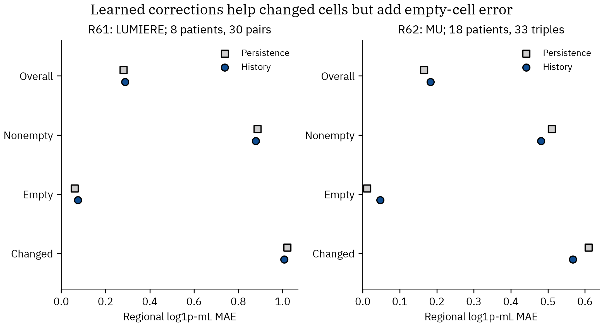

Descriptive patient-uniform error strata for the same R61 and R62 scoring cohorts. Empty and nonempty refer to the future target; changed cells exceed the fixed 0.1 log1p-mL absolute-change threshold. Strata overlap and must not be added. No stratum-specific intervals are supplied. Each panel has its own scale. The overall criterion still favors persistence.

[PDF](r61_r62_error_strata.pdf) · [Source aggregate](../../r61_corrected_history_metrics.json) · [Source aggregate](../../r62_mu_history_metrics.json)

## MU development allocation and history eligibility

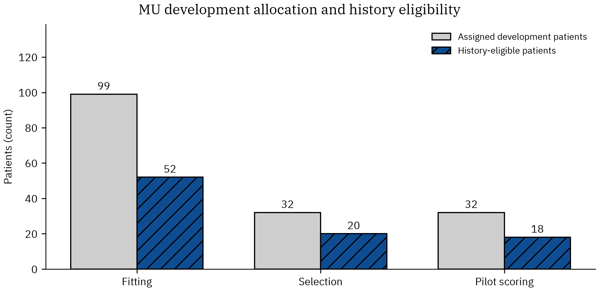

Assigned and history-eligible patient counts are overlapping categories, not stacked groups. The eligible partitions provide 107, 47, and 33 triples respectively. Metadata anomalies and missing released files exclude affected comparisons. Forty separately reserved patients remain unopened and are not represented by image or mask measurements in this plot.

[PDF](r62_development_cohort.pdf) · [Source aggregate](../../r62_mu_history_metrics.json)
